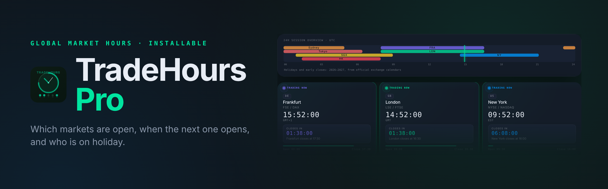
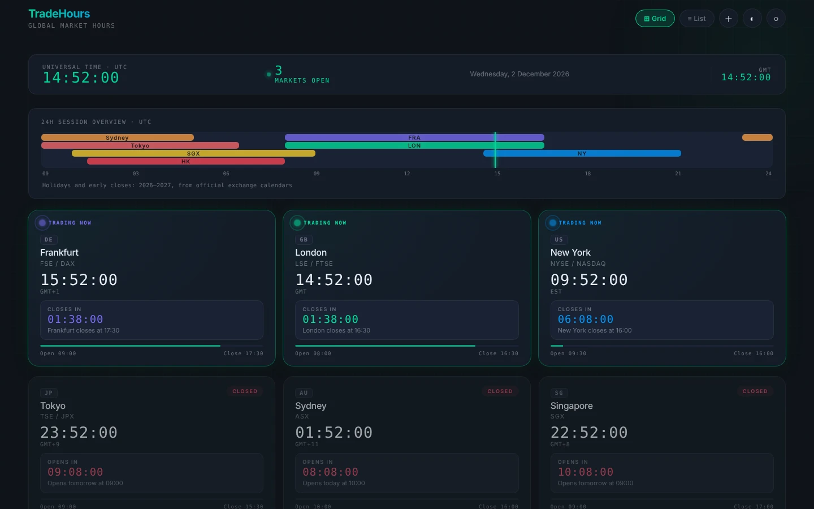
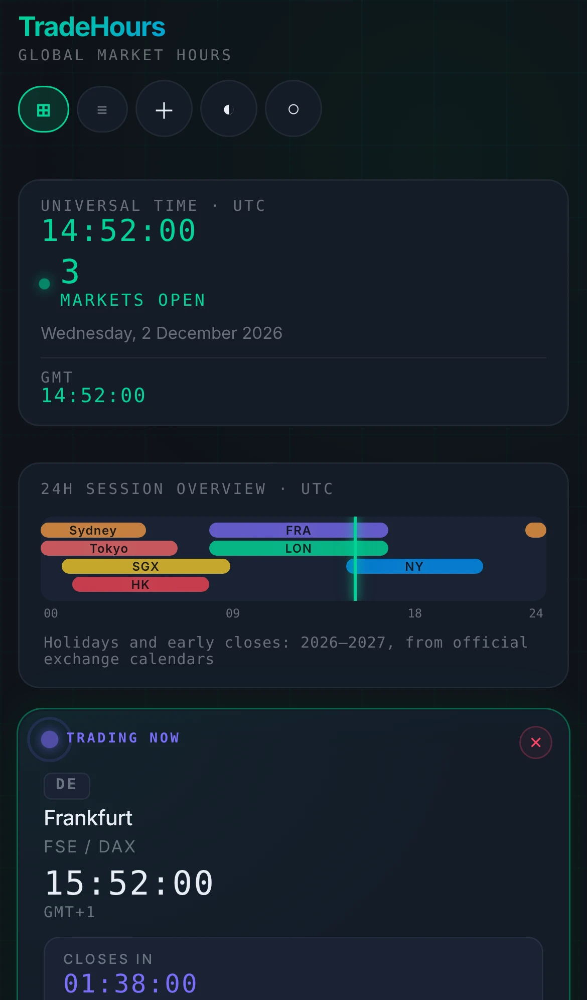
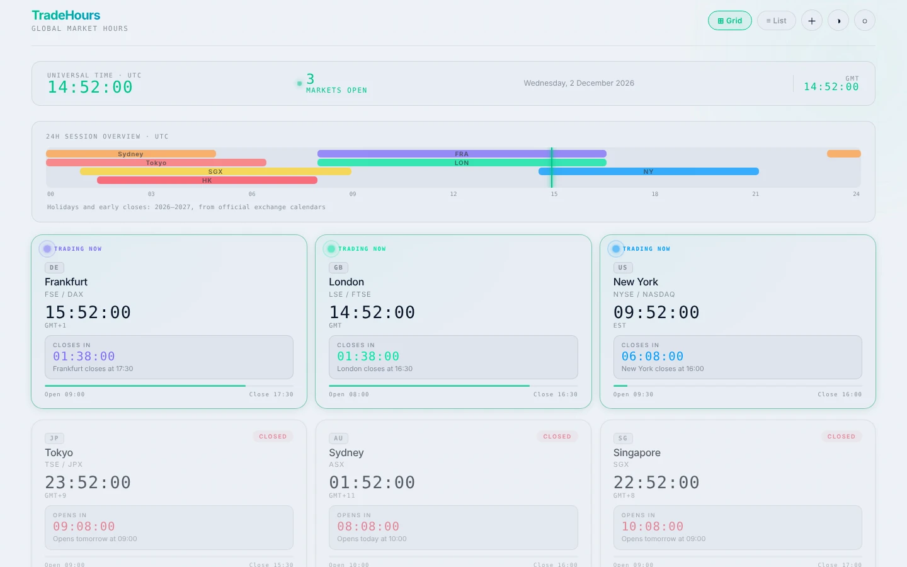

<p align="center">
  <a href="https://shazmoghaddam.github.io/tradehours-pro/">
    
  </a>
</p>

# TradeHours Pro

[](https://github.com/ShazMoghaddam/tradehours-pro/actions/workflows/ci.yml)
[](LICENSE)
[](CHANGELOG.md)
[](https://shazmoghaddam.github.io/tradehours-pro/)


Which markets are open right now, how long until the next one opens, and which are on holiday. Live global market hours for 25 exchanges, in one page you can install on your phone or desktop.

**[Open the live app →](https://shazmoghaddam.github.io/tradehours-pro/)**

**Contents:** [Features](#features) · [Screenshots](#screenshots) · [Holidays](#holidays-and-early-closes) · [How it works](#how-it-works) · [Install it](#install-it) · [Customise it](#customise-it) · [Run it](#run-it) · [Layout](#layout)

## Features

- **Live status** for each market: open, pre-market, closed, weekend or holiday, worked out in that market's own time zone.
- **Countdowns** to the close, or to the next real session, skipping weekends and holidays ("Opens Monday at 09:30").
- **Holidays and early closes** for 2026 and 2027 from official exchange calendars, including half days like Black Friday and Christmas Eve.
- **24-hour session timeline** in UTC, correct through daylight saving changes, with a line for "now".
- **25 markets in 6 regions** to add with one click, plus your own custom markets. Drag to reorder.
- **Local weekends:** Riyadh and Cairo trade Sunday to Thursday, Tel Aviv Monday to Friday.
- **Grid or list layout, dark or light theme**, and optional dimming from your device's light sensor. Everything is remembered.
- **Installable and offline:** add it to your home screen and it opens without a connection.
- **Accessible:** keyboard navigation, screen-reader labels, skip link and reduced-motion support.

## Screenshots

<table>
  <tr>
    <td width="66%"></td>
    <td width="34%" rowspan="2"></td>
  </tr>
  <tr>
    <td></td>
  </tr>
</table>

## Holidays and early closes

The built-in calendar covers **2026 and 2027**. It was checked on 27 November 2026 against:

| Market | Source |
|---|---|
| New York | [NYSE holidays and early closings, 2026 to 2028](https://ir.theice.com/press/news-details/2025/NYSE-Group-Announces-2026-2027-and-2028-Holiday-and-Early-Closings-Calendar/default.aspx) |
| London | [London Stock Exchange business days](https://www.londonstockexchange.com/en/resources/markets-products/business-days) |
| Frankfurt | [Deutsche Börse Xetra trading calendar](https://www.cashmarket.deutsche-boerse.com/cash-en/trading/trading-calendar-and-trading-hours) |
| Tokyo | [JPX market holidays](https://www.jpx.co.jp/english/corporate/about-jpx/calendar/index.html) |
| Hong Kong | Hong Kong general holidays ([EDB list](https://www.edb.gov.hk/attachment/en/curriculum-development/resource-support/guidelines-sch-calendar/General%20Holidays_2627_E.pdf)), with HKEX half days on Christmas Eve, New Year's Eve and Lunar New Year's Eve |
| Sydney | [ASX Trade calendar](https://www.asx.com.au/markets/market-resources/trading-hours-calendar/cash-market-trading-hours/trading-calendar.html) |
| Paris, Amsterdam | [Euronext trading hours and holidays](https://live.euronext.com/en/resources/trading-hours-holidays) (half-day close of 14:05 CET is Euronext's usual time; 2026 times are still to be announced) |
| Toronto | [TMX / TSX calendar](https://tsx.com/en/trading/calendars-and-trading-hours/calendar) |

Other markets in the directory follow their normal weekly hours. A line under the timeline shows the years covered and turns amber once the calendar is out of date. To extend it, add entries to `STATIC_HOLIDAYS` and update `HOLIDAY_YEARS`.

## How it works

- **Local time, done properly.** Every market's date, time and weekday come from `Intl.DateTimeFormat` in that market's time zone. `zonedToUtc()` turns a local open or close into the exact UTC moment, which keeps countdowns and the timeline right through daylight saving changes.
- **Next session.** When a market is closed, `nextOpen()` walks forward day by day, skipping that market's weekend and full-day holidays, and counts down to the first real open.
- **One tick a second.** All market times are worked out once per tick and cached, and the page only rebuilds the cards when a status actually changes.
- **Offline.** `sw.js` caches the app on the first visit. The page itself is network-first, so you get updates when online and the saved copy when not.

## Install it

- **iPhone or iPad:** open the live app in Safari, tap Share, then **Add to Home Screen**.
- **Android:** open it in Chrome, open the menu, then **Install app**.
- **Desktop Chrome or Edge:** click the install icon in the address bar.

Opened straight from disk, the app still works but can't be installed: browsers only allow service workers over `https`.

## Customise it

Everything is in `index.html`:

| What to change | Where to look |
|---|---|
| Markets shown on first visit | `DEFAULT_MARKETS` |
| Markets you can add | `MARKET_DIRECTORY` |
| Holidays and early closes | `STATIC_HOLIDAYS` and `HOLIDAY_YEARS` |
| Weekend days for a market | `WEEKENDS` (Saturday and Sunday by default) |
| Markets on the timeline | `anchors` in `buildTimeline()` |

## Run it

Open `index.html` in a browser. That's it.

To run the tests or rebuild the images, you need Node 20 or later:

```bash
npm install
npx playwright install chromium
npm test                 # smoke tests with the clock fixed to real dates
npm run build:assets     # banner, social preview and screenshots
```

## Layout

```
index.html                        the whole app: markup, styles, data and script
sw.js                             service worker for offline use
manifest.webmanifest              makes the app installable
icon.svg                          app icon
tradehours-pro-privacy-policy.html privacy policy
assets/
  banner.png                      README banner
  social-preview.png              GitHub social preview (Settings > Social preview)
  screenshots/                    README screenshots
  build.mjs                       builds all of the above from the live app
scripts/serve.mjs                 tiny static server used by the build and tests
tests/smoke.mjs                   headless browser tests, run in CI
```

## Not financial advice

TradeHours Pro shows scheduled exchange hours. Exchanges can change hours or close at short notice, so check with your broker before trading.

## Licence

[MIT](LICENSE)

---

Created by **Shaz Moghaddam** · London  
[Website](https://shazmoghaddam.github.io/) · [LinkedIn](https://www.linkedin.com/in/shazmoghaddam/)
